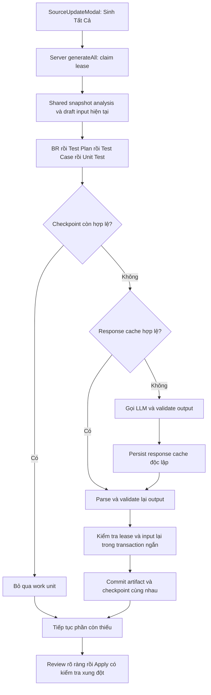

# GreyTest — Incremental Generation: audit và kiểm chứng

Thiết kế được duyệt ngày 24/10/2026. Phạm vi là pipeline dùng chung của GreyTest, không giới hạn ở source mẫu Patient Service. Không triển khai RAG và không sửa hành vi nghiệp vụ của source Java được kiểm thử.

## Nguyên nhân đã xác nhận

| File / function | Vấn đề trước thay đổi | Hướng xử lý |
| --- | --- | --- |
| FE `SourceUpdateModal.handleGenerateAll` | Luôn gọi lại BR → TP → TC → UT; trạng thái hoàn tất chỉ nằm trong React | Endpoint server `generate-all`, resume theo checkpoint, tải lại trạng thái server |
| `IncrementalGenerationService.generateIncrementalStage` | Không bind shared context, không có persisted lease/checkpoint | Scope dùng chung, lease có fencing, transaction ngắn cho ghi artifact |
| `generateIncrementalBusinessRules` | Đợi mọi response trước khi lưu; batch sau lỗi có thể làm mất response batch trước | Commit từng batch độc lập, giữ output hợp lệ khi phần khác thất bại |
| `resolveTargetMethodBatches` | Ghi source ứng viên lên method active trước Apply | BR đọc candidate snapshot; chỉ tạo identity tạm cần thiết trong transaction có fence |
| `GenerationContextBuilder.sourceAnalysis` / `SnapshotAnalysisLoader` | Quét lại source theo stage/request; context downstream đọc artifact active cũ | Snapshot source không chứa DB ID, persist có version/digest, remap ID hiện tại, overlay draft có hiệu lực |
| `LlmResponseCache.putAfterSuccessfulTransaction` | Incremental không có transaction nên không ghi cache; cache RAM mất khi restart | Cache PostgreSQL `REQUIRES_NEW`; chỉ response đầy đủ, đúng schema và qua semantic gate |
| `SourceDiffService.compareSnapshots` | Candidate bị scan hai lần; caller theo tên, mất phân biệt overload/module | Dùng lại candidate AST, dependency theo type/signature/module và evidence resource/build |
| `ImpactAnalysisService.analyzeImpact` | Lọc Service trước khi xét dependency; caller không đưa vào BR affected | Theo dependency tới Service rồi mới cascade BR → TP → TC → UT |
| `SourceUpdateService.analyzeUpdate` / `patchItem` / `applyUpdate` | Xóa draft khi phân tích lại; không kiểm tra revision; Apply thiếu chứng nhận stage | Giữ review, optimistic version/user revision, kiểm tra completeness và input/output hiện tại |
| `persistTestCases` | Xóa Unit Test con khi số case giảm mà không bảo vệ chỉnh sửa của người dùng | Giữ dữ liệu và tạo conflict cho đúng input liên quan |
| `IncrementalCheckpointCoordinator.activeSnapshot` / `SourceUpdateService.assertActiveBaselines`, `ensureCancelableArtifacts` | CREATE tạm bị bỏ qua khi chụp baseline; sửa qua API artifact rồi duyệt có thể mất cờ `isModified`, khiến Apply ghi đè hoặc Cancel xóa dữ liệu | Lưu snapshot đầu tiên của row tạm sau flush/coverage; so sánh trước resume/ghi/Apply/cleanup, giải quyết conflict rõ ràng |
| `UnitTestService.listFiles` / export | Hash toàn file làm test của method không đổi bị từ chối sau khi method khác thay đổi | Chỉ xác minh lại bản export nếu checkpoint đã Apply chứng minh input/output dependency và AST test còn nguyên; giữ hash lịch sử và DB source |

## Quy tắc lưu trữ và resume



Fingerprint là SHA-256 của manifest JSON canonical, gồm stage/project, input nghiệp vụ hiệu lực, prompt/source-contract digest, cấu hình provider/model/token/locale, validator identity và dependency/resource digest. Revision, review và digest output được kiểm tra riêng cùng fingerprint, không được coi cache hit là quyết định duyệt.

| Stage | Đơn vị checkpoint và input cần theo dõi |
| --- | --- |
| BR | Method đích và dependency transitively resolved, source branch/resource context |
| Test Plan | BR/method được nhắm tới, BR hiệu lực và coverage liên quan |
| Test Case | Test Plan cùng nội dung/coverage/BR hiệu lực |
| Unit Test | Test Case cùng input upstream, production API được mã test thực sự gọi và tài nguyên/build liên quan |

Một work unit có thể sinh nhiều artifact; checkpoint lưu danh sách item, revision và digest từng output. Thay đổi nội dung review không làm lệch fingerprint do timestamp/status thuần hiển thị, nhưng quyết định review và revision vẫn phải khớp để reuse.

- V27 additive: `llm_response_cache`, `generation_checkpoint`, version cho source update/item và user revision cho item.
- Lease theo project/update sử dụng thời gian PostgreSQL và token/fence. Worker hết lease không được ghi artifact, trạng thái hoặc checkpoint thành công.
- Không giữ transaction trong lúc gọi LLM. Artifact và checkpoint thành công cùng commit trong một transaction ngắn. Cache response đã validate được persist độc lập.
- Fingerprint gồm source/dependency/resource/build, input hiệu lực, prompt/source contract, provider/model/cấu hình/locale và validator version. Dependency chỉ được gọi trong mã test cũng có provenance riêng.
- Checkpoint chỉ được skip khi fingerprint, output digest, revision, dependency và validator còn hợp lệ. Response cache hit luôn parse và validate lại.
- Chỉnh sửa hoặc quyết định của người dùng được giữ; proposal xung đột lưu riêng, phải giải quyết bằng version/revision hiện tại. KEEP sử dụng dữ liệu active cho downstream và Apply.
- Checkpoint lịch sử ngoài tập target hiện tại không được tính là phần còn thiếu. Lịch sử vẫn được giữ để kiểm tra provenance.
- Source metadata khi export: không đổi source trong database hoặc sửa hash lịch sử. Bản export có metadata xác minh hiện tại và audit riêng, chỉ khi bằng chứng dependency/AST đầy đủ; trường hợp khác báo lỗi để sinh lại phần bị ảnh hưởng.

## An toàn database

V27 đã được áp dụng trên database chính `greytest` ngày **25/10/2026**, sau khi kiểm chứng schema, backup và migration trên bản phục hồi riêng. Flyway validate cả 27 migration thành công; chỉ chạy một migration V27 mới. Nội dung và số dòng của **23 bảng lịch sử giữ nguyên**, kiểm tra bằng count và digest toàn bảng trước/sau (loại các cột version mới khỏi phép so sánh).

| Database | Thao tác đã chạy | Kết quả |
| --- | --- | --- |
| `greytest_incremental_test_20261024` | Phục hồi backup V26, chạy V27, kiểm thử tích hợp | PostgreSQL 15; giữ 27 project, 1.471 BR, 488 TP, 858 TC, 649 UT, 12 update, 138 item lịch sử |
| `greytest_v27_verify_20261025` | Phục hồi backup mới, so sánh toàn bộ bảng với primary, chạy V27 | 23 bảng trùng nội dung primary trước migration và không đổi sau migration |
| `greytest` | Flyway V26 → V27 sau khi các bước trên và regression thành công | Một migration đã áp dụng; validate thành công; 23 bảng lịch sử không đổi |

Backup lưu ở workspace `.greytest-generation-verification/backups/`:

- `greytest-pre-v27-20261024.dump`: 2.265.353 byte; SHA-256 `1D4912DB4D28DD07512EB0A56F55CD8A8A0795B3CBB11E4ABBCDE5563B0E6048`.
- Backup mới ngay trước khi migrate primary: `greytest-pre-v27-final-20261025.dump`, 2.265.353 byte; SHA-256 `05BE60E48B00F0CE708541D05FCE38BBB0DDC06804A143EA88B3F3C87F43B790`.
- Đã kiểm tra catalog backup và phục hồi thực tế bằng UTF-8. Client PostgreSQL 17 sinh `SET transaction_timeout` chưa có trong PostgreSQL 15; chỉ loại câu SET phiên làm việc đầu file khi phục hồi bản test, không thay câu lệnh schema/data.

Chứng cứ trong workspace `.greytest-generation-verification/incremental-optimization/`: `final-restore-migration-verification.json/.log`, `primary-v27-verification.json/.log`. Không gọi LLM trên primary, không chạy test vào primary và không triển khai/restart backend.

## Phương pháp benchmark

Fixture dùng pipeline Spring/JPA/parser/context/validator thật; chỉ thay biên `LlmClient` bằng provider kiểm thử xác định, không gọi API bên ngoài. Sáu method, 24 proposal UPDATE, concurrency 1; một cặp warm-up bị loại, ba cặp cold/repeat được đo bằng thời gian thực và so sánh digest trong từng cặp. Đo tổng lượt sinh BR → TP → TC → UT; không bao gồm startup, tạo fixture, upload/unzip/analyze hay chạy build của project Java được kiểm thử.

Baseline đã được đo trước khi sửa production source:

| Workload | Thời gian từng mẫu (ms) | Median (ms) | Provider calls / lượt | Scanner events / lượt |
| --- | --- | --- | --- | --- |
| Cold | 628,8924; 556,6172; 548,2412 | 556,6172 | 5 | 3 |
| Source không đổi, bấm lại | 521,1140; 463,6535; 550,6620 | 521,1140 | 5 | 3 |

File raw: workspace `.greytest-generation-verification/incremental-optimization/benchmark-before.json` và CSV/log cùng tên. Bản trước được giữ riêng, không ghi đè.

Sau khi gate BR được áp dụng đầy đủ, provider kiểm thử bổ sung `branch_id` lấy từ source anchor; mô tả nghiệp vụ, expected result, source fixture và batch size được giữ nguyên. Instrumentation cuối phải bật rõ mức log của scanner hoặc đọc metric parser để không nhầm log bị tắt với việc không parse.

Sau tối ưu, đo qua một lời gọi `generate-all` giống luồng frontend hiện tại. Baseline dùng bốn lời gọi stage liên tiếp giống frontend trước thay đổi. Cả hai đều chạy đủ BR → TP → TC → UT.

| Workload sau tối ưu | Thời gian từng mẫu (ms) | Median (ms) | Provider calls / lượt | Scanner events / lượt | Artifact sinh lại / checkpoint skip |
| --- | --- | --- | --- | --- | --- |
| Cold | 1.111,4251; 988,3765; 1.117,0642 | **1.111,4251** | 5 | 1 | 24 / 0 |
| Source không đổi, bấm lại | 472,8116; 418,1965; 403,0093 | **418,1965** | **0** | **0** | **0 / 24** |

P95 theo nearest-rank với ba mẫu chính là giá trị lớn nhất: baseline cold/repeat 628,8924 / 550,6620 ms; sau tối ưu 1.117,0642 / 472,8116 ms. Ba mẫu nhỏ và có khoảng thời gian chồng lấn, không đủ để khẳng định cải thiện latency ổn định. Repeat có median/P95 thấp hơn trong fixture này; cold vẫn cao hơn. Chi phí kiểm tra dependency, output và transaction tăng rõ khi provider giả lập trả lời gần như tức thì. Chưa đo latency/cost của provider production.

Mỗi lượt repeat có 24 checkpoint skip, 4 stage skip, 5 batch skip, 0 artifact sinh lại, 0 full source scan và 1 persistent analysis hit. Vẫn đọc/hash source để kiểm tra tính hợp lệ, parse phần evidence/output cần xác minh; **0 scanner event không có nghĩa là không còn bất kỳ lần parse AST nào**. Cache response không được lookup khi checkpoint đã đủ: hit rate response cache cho workload này là **N/A**, không phải 0%.

Cold có 5 cache miss; repeat không gọi provider. Raw JSON chứa số đo wall time của từng stage, tổng pipeline, provider duration và counter phân tích/dependency/output. File sau tối ưu cuối, đo sau bản sửa CREATE và metric: `benchmark-after-reviewed-final.json/.csv`; kết quả test trong `benchmark-reviewed-final.log`. Các lượt trung gian được giữ riêng, không dùng thay cho số đo cuối. Mọi file benchmark đều nằm tại thư mục chứng cứ workspace đã nêu.

Median wall time từng stage (ms; tính độc lập nên không cộng các median để suy ra median tổng):

| Stage | Cold trước → sau | Repeat trước → sau |
| --- | --- | --- |
| BR | 183,1013 → 259,0936 | 142,5153 → 116,8418 |
| Test Plan | 95,9221 → 177,5454 | 104,7791 → 86,7606 |
| Test Case | 119,8402 → 182,7973 | 93,5912 → 68,8080 |
| Unit Test | 195,3287 → 374,2267 | 160,5583 → 92,2052 |

Có thể đo lại từ thư mục backend với database test đã tạo, credentials test qua môi trường, tuyệt đối không dùng URL primary:

```powershell
$env:SPRING_DATASOURCE_URL='jdbc:postgresql://localhost:5433/greytest_incremental_test_20261024'
$env:LLM_PROVIDER='mock'
mvn -o '-Dtest=IncrementalPipelineBenchmarkTest#benchmarkColdAndUnchangedRepeat+missingUnitCheckpointsRecoverFromValidatedPersistentCacheWithoutCallingProvider' '-Dbenchmark.phase=after-local-rerun' '-Dbenchmark.api=all' test
```

Đổi phase thành tên mới để giữ các kết quả đối chiếu. Harness chặn ghi đè baseline `before`; phase khác vẫn có thể bị ghi đè nếu dùng lại tên.

### Các workload kiểm chứng bổ sung

Đây là các lần chạy kiểm chứng đơn, có ghi wall time và counter thực tế; không có baseline latency cho các scenario này, nên không dùng để tuyên bố tăng tốc trước/sau.

| Tình huống | Provider calls | Checkpoint skip / artifact sinh lại | Kết quả |
| --- | --- | --- | --- |
| Một method thay đổi | 4 | 20 / 4 | Chỉ chuỗi BR → TP → TC → UT phụ thuộc method đó được sinh lại |
| Helper/dependency của một method thay đổi | 4 | 20 / 4 | Các method không phụ thuộc giữ checkpoint |
| Retry sau lỗi ở UT | 1 | 18 / 6 | 18 artifact đã commit được giữ, chỉ tiếp tục stage UT |
| Request trùng khi request khác còn lease | 0 lời gọi thêm | Không tạo artifact trùng | Request thứ hai bị từ chối; worker cũ hết lease không commit được |
| Checkpoint/output hỏng | Theo phần cần sửa | 23 / 1 | Không coi output hỏng là thành công |
| Mất checkpoint UT nhưng còn response cache hợp lệ | 0 | 18 / 6 | 1 response cache hit, parse và validate lại đủ 6 output trước khi ghi checkpoint |
| Artifact đã sửa/duyệt | Không tự ghi đè | Conflict theo target | Giữ quyết định người dùng, yêu cầu giải quyết và xác minh lại |

Recovery từ response cache có hit rate **1/1 = 100% trong đúng workload này**, digest/ID output giữ nguyên. Đây không phải hit rate production. Chứng cứ riêng: `scenario-target-and-dependency.json`, `scenario-retry.json`, `scenario-concurrent.json`, `scenario-corrupt-checkpoint.json`, `scenario-persistent-cache.json`, `scenario-protected-edit.json`.

## Kiểm thử và giới hạn

Các lệnh Spring integration đều chỉ định `SPRING_DATASOURCE_URL=jdbc:postgresql://localhost:5433/greytest_incremental_test_20261024`, `LLM_PROVIDER=mock`; không dùng cấu hình mặc định trỏ primary.

- Backend full regression cuối sau bản sửa CREATE và metric: **1.145 test, 0 failure, 0 error, 1 skipped**, `BUILD SUCCESS`; log `backend-full-preservation-final.log`. PetClinic golden manifest được skip vì thiếu checkout ngoài repo (`-Dpetclinic.path`).
- Hai test benchmark/recovery response cache cuối pass sau bản sửa CREATE, không failure/error/skip; log `benchmark-reviewed-final.log`.
- Frontend: **53 file / 254 test pass**, build thành công; log `frontend-full-final.log`, `frontend-build-final.log`. Build còn cảnh báo chunk size vốn có.
- Review độc lập chỉ đọc đã xử lý các lỗi correctness, bảo vệ dữ liệu, lease/fencing, dependency/dispatch, export provenance và vòng đời AST cache. Bản sửa CREATE cuối cũng đã được reviewer kiểm tra, không còn phát hiện cần xử lý trong phạm vi review.
- Regression CREATE đã tái hiện trên PostgreSQL thật: 5/5 case mới fail trước bản sửa, gồm Apply ghi đè BR/TP/TC đã sửa, Cancel xóa BR đã sửa rồi duyệt (`isModified=false`) và thiếu baseline lúc tạo. Hai regression unit cũng fail trước bản sửa: checkpoint fast-skip bỏ qua thay đổi physical row và counter đếm input thay vì artifact. Chứng cứ RED: `temp-create-preservation-red.log`, `temp-create-cache-and-metrics-red.log`.
- Sau bản sửa: **56/56 test thuộc năm suite liên quan pass**, không failure/error/skip, gồm 9 case PostgreSQL cho temp CREATE và 9 case coordinator. Log `temp-create-preservation-green.log`. KEEP_USER giữ row người dùng; USE_PROPOSAL chỉ refresh baseline qua xác nhận xung đột có khóa/revision và snapshot hiện tại còn khớp. Artifact counter đếm ID output thực tế, loại trùng và loại item không thuộc response. Các case này cũng đã pass trong full regression 1.145 test ở trên.

Các mốc test có giao nhau, không cộng thành một tổng mới. Giới hạn còn lại:

- Không hứa exactly-once cho provider ở cửa sổ tiến trình chết sau khi nhận response nhưng trước khi persist cache/checkpoint. Fencing vẫn ngăn worker cũ commit artifact.
- Dependency mơ hồ (runtime dispatch không xác định, reflection hoặc API generated chưa resolve được) bị chặn để xử lý rõ ràng; không biến thành checkpoint thành công hay tự sinh lại cả project.
- Test lịch sử thiếu provenance đáng tin cậy không được tự đổi metadata để vượt source gate. Export chỉ xác minh lại metadata khi checkpoint đã Apply, dependency và AST test đủ bằng chứng; trường hợp khác phải sinh lại phần liên quan.
- Chưa benchmark LLM production, project lớn hoặc tải nhiều worker để khẳng định latency/cost thực tế. Regression đồng thời kiểm tra correctness, không phải load test.
- Metadata cache/checkpoint có format, validator, source/input/output dependency và prompt/config provenance; chưa có vector store hoặc RAG.

## File đã thay đổi

Danh sách backend so với bản chụp trước tác vụ và bốn file frontend thuộc tác vụ lưu tại workspace `.greytest-generation-verification/incremental-optimization/files-changed-from-baseline.txt`. Backend được so sánh bằng SHA-256; frontend ghi theo file đã sửa/review vì không lưu snapshot đầy đủ từ trước. Không dùng toàn bộ `git diff` làm danh sách của tác vụ vì checkout đã có thay đổi chưa commit từ trước.

| Phần | File chính |
| --- | --- |
| Shared analysis | `service/GenerationJobContext.java`, `service/agent/GenerationContextBuilder.java`, `SnapshotAnalysisLoader.java`, `PersistentSourceAnalysisService.java`, `service/diff/SourceDiffService.java` |
| Cache, lease và resume | `service/generation/PersistentLlmResponseStore.java`, `GenerationCheckpointStore.java`, `IncrementalCheckpointCoordinator.java`, `service/IncrementalGenerationService.java`, `service/agent/AIAgentService.java` |
| Fingerprint và impact | `service/generation/GenerationFingerprintService.java`, `SourceDependencyIndex.java`, `SourceDispatchResolver.java`, `GeneratedOutputDependencyResolver.java`, `GenerationImpactValidator.java`, `service/diff/ImpactAnalysisService.java`, `SnapshotModuleAliases.java` |
| Review, Apply và export | `service/SourceUpdateService.java`, `SourceBranchReference.java`, `UnitTestService.java`, `service/generation/UnitTestExportProvenanceService.java`, entity/DTO/mapper/repository source update |
| API và frontend | `controller/SourceUpdateController.java`, FE `SourceUpdateModal.tsx`, API/types và test liên quan |
| Database | `src/main/resources/db/migration/V27__incremental_generation_checkpoint_and_cache.sql` |
| Regression và benchmark | `IncrementalPipelineBenchmarkTest`, `DurableGenerationStoresIntegrationTest`, `GenerationFingerprintServiceTest`, `DependencySourceDiffTest`, `SourceUpdateProtectionIntegrationTest`, `TemporaryArtifactPreservationIntegrationTest`, `UnitTestExportProvenanceIntegrationTest` cùng test context/lifecycle/UI liên quan |
