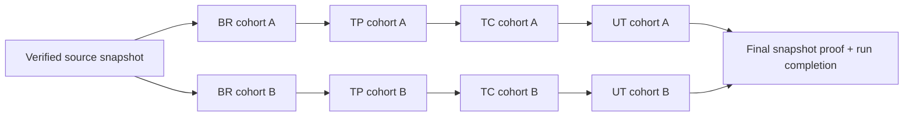

# Phase 3 — Thiết kế để review, chưa triển khai scheduler

Ngày: 2026-11-03. Baseline: `21174ef` (bao gồm `fc2c5e5`, `39a7622`). Nhánh: `perf/source-update-performance`.

## Quyết định hiện tại

Giữ scheduler hiện tại. Chỉ bổ sung profiler trong test scope và tài liệu. Chưa thay stage barriers, schema, batch size, concurrency mặc định, semantic validator, fingerprint, protected edits hoặc Apply. Số liệu và giới hạn đo nằm trong [báo cáo critical path](source-update-e2e-critical-path.md).

Một method mới chỉ có một chuỗi BR → TP → TC → UT. DAG không rút ngắn được bốn dependency bắt buộc của chuỗi này. Lợi ích tiềm năng của DAG nằm ở nhiều cohort độc lập, có thời gian batch lệch nhau. Ưu tiên tiếp theo là giảm chi phí local lặp lại đã đo, sau khi review thiết kế cache bên dưới.

## 1. Hành vi thực tế phải giữ

- `IncrementalGenerationService.generateAll` gọi bốn stage theo thứ tự. `IncrementalCheckpointCoordinator.beginStage` yêu cầu marker `__stage__` của stage trước đã `SUCCEEDED`.
- `LlmBatchExecutor.map` chia worker có giới hạn, xử lý các batch độc lập trong cùng stage, giữ thứ tự kết quả theo input và chọn lỗi có batch number nhỏ nhất. Nó đợi `allOf(...).join()` trước khi trả về. Worker đang rảnh có thể poll queue 30 ms đến khi batch cuối hoàn tất. Không đồng nhất khoảng này với monitor contention.
- Claim/fence/lease hiện tại bảo vệ **run**, chưa phải một hàng đợi task DAG có atomic claim. `GenerationJobService.executeMutation` còn chặn mutation đồng thời trong cùng process. Chỉ bỏ vòng lặp stage không tạo ra scheduler an toàn.
- `executeBatch` kiểm tra input fingerprint/checkpoint; generate bên ngoài transaction; validate response; rồi transaction kiểm tra lại lease, protected edits, input context/fingerprint mới và snapshot trước khi ghi artifact cùng checkpoint. Output dependency chưa chứng minh được thì giữ draft và đánh dấu `BLOCKED`, không coi là thành công.
- `completeStage` thực hiện proof toàn snapshot trước khi commit marker. Run kết thúc cũng kiểm tra source. WatchService chỉ là tín hiệu phát hiện thay đổi sớm, không thay thế content proof.
- Artifact dùng làm upstream trong source update có thể là proposed draft. Điều đó không trao quyền phê duyệt business rule hay bỏ review trước Apply.

Các file chính: [orchestrator](../src/main/java/com/greytest/service/IncrementalGenerationService.java), [checkpoint coordinator](../src/main/java/com/greytest/service/generation/IncrementalCheckpointCoordinator.java), [batch executor](../src/main/java/com/greytest/service/LlmBatchExecutor.java), [context builder](../src/main/java/com/greytest/service/agent/GenerationContextBuilder.java).

## 2. Shared context reuse: phạm vi đề nghị

`SourceSnapshotSession` hiện chia sẻ dependency index qua worker nhờ `GenerationJobContext`. Không đưa mutable DTO/entity/AST/symbol solver vào một map rồi cho các worker dùng tùy ý. Index có nội bộ mutable và synchronization; cache DTO bất biến không đồng nghĩa AST bên dưới đã thread-safe.

Chia thành hai lớp dữ liệu với điều kiện hợp lệ riêng:

| Dữ liệu | Key và điều kiện | Cách dùng dự kiến |
|---|---|---|
| Method metadata, source contract, source excerpts | snapshot identity + content digest + classpath/config digest + analyzer/contract version + qualified signature | DTO bất biến; source range và hash phải thuộc đúng snapshot; không cắt bỏ dependency evidence |
| Dependency closure | toàn bộ key của index + canonical method key + resolution policy/version | Giữ trạng thái unresolved/conservative; không biến cache miss thành closure rỗng |
| Existing tests metadata | source snapshot nếu test file nằm trong proof; nếu từ DB thì project/source mapping epoch + tập row ID/version/content digest | Phân biệt approved tests, generated proposals và protected edits |
| Upstream BR/TP/TC references | update/run identity + stage + target/cohort membership + artifact ID, version, userRevision, reviewStatus, action, digest(afterData) + baseline/source mapping | Freeze theo version vector; validate lại trước commit; không giữ entity JPA qua thread |

Không dùng `projectId + methodId` hoặc timestamp đơn lẻ làm key cho stage context. `relatedRuleIds` của TP mở rộng đến toàn bộ rule thuộc method; membership của tập rule cũng phải có trong key. UT có context của previous approved cases/tests của cùng plan; một case được commit thêm có thể làm đổi input case khác dù method source không đổi.

Đề nghị thử nghiệm nhỏ trước: cache riêng phần source contract/metadata/excerpt bất biến trong session, ghép phần upstream hiện hành mỗi lần. Đo lại số parse, query và wall time. Không memoize toàn bộ `snapshotContext` xuyên stage. Giữ nested `withInputSnapshot` mới trước commit: đó là read barrier chống thay đổi input trong lúc LLM chạy.

Fallback: thiếu provenance, snapshot không đáng tin, index key đổi, classpath/POM/Lombok đổi → cache miss/verified rebuild hoặc `SOURCE_ANALYSIS_UNRESOLVED` theo semantics hiện có. Không quy các lỗi này thành provider retry.

## 3. DAG khả thi đến đâu?

### Đơn vị dependency là cohort có version

Không mặc định mỗi method là một task độc lập. BR hiện gom tối đa 3 method cùng service; TP gom rule theo method rồi tối đa 8 method; TC/UT tối đa 4 artifact và có thể trộn method. TP có thể phụ thuộc cả hai BR batch. UT sibling context còn liên quan các case cùng plan.

Nếu thay grouping để chạy sớm hơn thì prompt, input fingerprint, output phân nhóm và chất lượng có thể thay đổi. Đây phải là một thí nghiệm riêng, không được gọi là scheduling thuần túy và giả định artifact giống nhau.

Để thử scheduler trước mà hạn chế thay đổi output: freeze manifest batch và các reference cohort đúng như legacy; tạo edge cho **toàn bộ** input mà batch sẽ đọc. Batch chỉ ready khi tất cả prerequisite batch đã validate và commit, version vector vẫn khớp. Nếu graph sinh ra không đủ độc lập thì chấp nhận ít lợi ích.

Đây là trường hợp hai cohort thật sự độc lập. Nếu TP batch chứa cả A và B, phải nối cả hai edge vào batch đó; không dùng sơ đồ để bỏ dependency thực tế.

### Protocol được đề nghị, chưa có code/migration

1. Trong run claim hiện có, tạo manifest xác định từ source proof, target order, batch policy version và upstream membership. Task identity ổn định qua retry/resume: `(update, manifestVersion, stage, ordered target IDs)`; không dùng thứ tự thread hoàn tất.
2. Task có trạng thái READY/RUNNING/SUCCEEDED/FAILED/BLOCKED/CONFLICT/CANCELLED, owner, lease, fence, attempt, prerequisite version vector. Có thể bổ sung bảng task hoặc mở rộng checkpoint; cần review schema riêng, chưa quyết định migration.
3. Atomic claim bằng conditional update/row locking trong transaction ngắn. Worker chỉ claim khi prerequisite checkpoint đã `SUCCEEDED` và version khớp. Có run fence và task fence; worker hết lease không được ghi kết quả.
4. Sau claim: đóng transaction, build context, gọi provider với budget/retry hiện có. Giới hạn concurrency toàn backend, mỗi user tier và mỗi run; ready queue có capacity hữu hạn. Không giữ connection/row lock trong lúc gọi LLM, sleep retry hoặc chờ prerequisite.
5. Validate đầy đủ ngoài transaction; trong transaction ngắn kiểm tra lease/fence, reference versions, source proof, protected edits và fresh input fingerprint như hiện tại. Ghi artifact + output fingerprint/provenance + task checkpoint trong cùng transaction. Ready signal chỉ phát **sau commit**.
6. Retry sau crash trước commit không để lại artifact; sau commit nhưng trước ready signal phải discover checkpoint và phát lại signal, không sinh trùng. Unique target identity và upsert có fence là yêu cầu, không dựa vào Java `synchronized` để bảo vệ nhiều process.
7. Resume dựng ready set từ manifest/checkpoint đã chứng minh hợp lệ; không tin cờ SUCCEEDED khi draft digest, user revision, validator/analyzer version hoặc input vector đổi. Failed target chỉ chặn descendants; batch độc lập vẫn hoàn tất theo policy hiện tại.
8. Kết thúc run: drain mọi task đang ghi, kiểm tra snapshot toàn bộ; tạo marker tương thích stage/Apply từ tập checkpoint hợp lệ. Không phát `SUCCEEDED` cho stage còn target BLOCKED/CONFLICT. Chọn lỗi theo `(stage ordinal, original batch ordinal, target ID)`, không theo race hoàn tất.

`AtomicInteger` cấp BR/TP/TC code và lookup artifact hiện tại có scope theo stage. Không gọi đồng thời các entry point stage cho từng method rồi coi đó là DAG: có thể cấp code trùng, tạo duplicate hoặc ghi đè artifact. Cần allocator/claim chung cho run, được kiểm chứng trước.

### Backpressure, pause và rollback

- Cấu hình đề nghị `greytest.source-update.scheduler=legacy|dag`, mặc định `legacy`; đây mới là thiết kế, chưa thêm property vào runtime. Ghi scheduler/manifest version vào run checkpoint.
- Giới hạn số active task và tổng context bytes/tokens; không enqueue vô hạn mọi ready node. Concurrency theo throughput đo được, không theo số CPU hoặc số task đơn thuần.
- Pause/cancel ngừng claim mới, drain/commit hoặc hủy theo fence những task đang chạy; giữ khả năng resume. Không đổi quyền sửa hoặc Apply.
- Rollback chỉ ở ranh giới run an toàn: dừng claim, drain workers, giữ checkpoint/artifact hợp lệ, quay legacy với cùng proof. Nếu manifest/semantics không tương thích thì mở lại run qua reconciliation/invalidation; không vừa đổi flag vừa chạy cả hai scheduler trên cùng update.
- Legacy stage markers chỉ được tái tạo sau kiểm tra đủ target; không sửa thành SUCCEEDED để vượt barrier khi còn task thiếu.

## 4. Regression tests phải viết trước khi đổi scheduler

| Tình huống | Chứng minh bắt buộc |
|---|---|
| Một method mới, body/signature đổi, xóa method | Impact/target và artifact giống legacy; signature/delete không giữ target cũ |
| DTO/entity, overload mới, POM/classpath/Lombok đổi | Invalidate đúng closure/config; không dùng stale index |
| A nhanh, B chậm, độc lập | TP(A) chỉ chạy sau commit BR(A); có thể overlap BR(B); deterministic reporting |
| Shared TP cohort hoặc sibling UT context | Không ready sớm; upstream membership/version thay đổi phải invalidate |
| Crash trước/sau artifact commit, trước ready signal | Không duplicate/mất artifact; resume không gọi lại target hợp lệ |
| Hai process claim, lease hết, heartbeat lỗi | Một owner được ghi; stale fence bị từ chối |
| Protected edit/review/Apply trong lúc generate | Conflict được giữ, không ghi đè hoặc tự approve |
| Cache provenance thiếu, output dependency unresolved | Cache miss/BLOCKED đúng lớp lỗi; validator vẫn bắt lỗi thật |
| Retry budget, quota, rate limit, bounded queue đầy | Backpressure có giới hạn; không deadlock hoặc tăng call budget |
| Pause/cancel/resume, đổi flag | Drain an toàn và rollback đúng marker/fence |
| Chạy song song nhiều batch/run | Không chia sẻ mutable AST/entity không an toàn; deterministic codes/ordering |

So sánh golden: canonical artifact data (loại bỏ ID/timestamp kỹ thuật **chỉ trong comparator**), impact method keys, input/output provenance, protected user revisions, compile pass và JUnit runtime pass. Với provider thật không xác định: cố định model/config, ghi usage, lặp nhiều lần, so sánh chất lượng và tỷ lệ lỗi; không yêu cầu byte-identical JSON để thay thế semantic evaluation.

## 5. Incremental diff và adaptive batching

**Manifest diff:** có thể tránh đọc/parse file không đổi khi có manifest đáng tin và snapshot proof. Key gồm normalized path + byte digest + analyzer/classpath/config. Không dùng mtime/size làm chứng cứ nội dung duy nhất. Compare semantic method identity, không chỉ text body. Đổi overload/type/DTO/dispatch có thể ảnh hưởng caller chưa có edge trong graph cũ; nếu reverse graph/resolution thiếu phải mở rộng conservative hoặc full analysis.

**AST reuse:** lưu immutable extracted facts sẽ dễ giải thích và an toàn hơn chia sẻ JavaParser AST/symbol solver tùy ý. Chưa đủ số liệu để bỏ full-source proof ở ranh giới stage/run. Đo source digest riêng; không gộp source reads với index reads để kết luận số file parse.

**Batching:** giữ legacy làm control. Thử riêng size 1/2/3 method BR, 1/2/4 artifact TC/UT và concurrency 1/2/4 trên cùng dense fixture/provider. Ghi context bytes, actual tokenizer/usage nếu provider cung cấp, semantic failures, truncation, retry, compile/JUnit pass, DB/CPU/queue và p50/p95. Prompt characters không phải tokens. Chỉ gom task có prerequisite sẵn sàng và context version tương thích. Token cap không được làm mất branch contract hoặc supporting type cần cho UT.

## 6. Thứ tự triển khai sau review

1. Review số liệu, bổ sung một project đại diện và provider/config thật; đo profiler overhead bằng control cùng fixture. Chưa gọi fixture hiện tại là production benchmark.
2. Thử cache source-only context nhỏ, đo trước/sau và regression; giữ fresh upstream/precommit checks.
3. Đánh giá lại lợi ích barrier bằng trace có skew thực tế. Viết regression của manifest/claim trước, rồi mới thử scheduling trên manifest giữ nguyên batching, flag mặc định tắt.
4. Đổi grouping/adaptive batching là thí nghiệm riêng, kèm đánh giá UT quality.

Full DAG với durable task claims, fencing, version vector, marker compatibility và UI progress là thay đổi đáng kể đối với đồ án hai người; có khả năng vượt một tuần. Cần thống nhất phạm vi trước khi triển khai. Đề nghị review cache source-only trước; không triển khai đồng loạt Phase 3.
