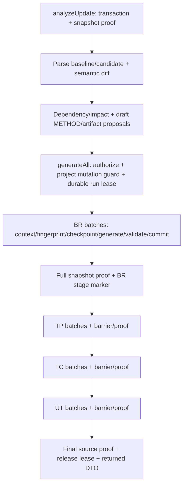

# Phase 3 — Audit và profiling critical path source update

Ngày: 2026-11-03. Source baseline: `21174ef`, bao gồm `fc2c5e5` và `39a7622`. Nhánh: `perf/source-update-performance`. Không push main.

Profiler và reproducible harness: commit `1dccce5`; thay đổi chỉ ở test scope và script tổng hợp benchmark.

## 1. Phạm vi và bằng chứng đã có trước khi sửa

Đã đọc [báo cáo Phase 1/2](source-update-performance-optimization.md), các JSON benchmark liên kết trong đó và đường gọi Analyze → generateAll → checkpoint/context/fingerprint/provider/persist trước khi thêm profiler. Phase 3 hiện chỉ bổ sung **test-only instrumentation**, benchmark và thiết kế. Không có production optimization mới để so sánh trước/sau; không trình bày cold/warm như speedup của một bản optimized.

Kết quả đã ghi ở baseline trước:

| Workload cũ, provider local xác định | Median trước → sau Phase 2 | Giới hạn |
|---|---:|---|
| Một method mới, project nhỏ | 1602.597 → 1868.157 ms | Chậm hơn 16.6%; 3 mẫu, không kết luận tail |
| Cùng thay đổi, thêm 128 class không liên quan | 6926.673 → 3658.069 ms | Dependency walks 10 → 3, reads 1290 → 387; synthetic local |
| Sáu method, generateAll cold | 2101.159 → 2195.798 ms | Chậm hơn 4.5% trên fixture nhỏ |

Như vậy giảm full-source scans đã được chứng minh, nhưng không chứng minh toàn bộ pipeline nhanh hơn ở project nhỏ. Không có cơ sở quy chậm cho API key hoặc provider. Những số trên không cùng cấu hình concurrency/logging/sample với lượt Phase 3, nên không dùng làm phép so sánh tốc độ giữa hai lượt đo.

## 2. Đường gọi thực tế



Đây là API source update đồng bộ, không phải `GenerationJobService.submit` chờ outer generation job executor. `generateAll` mở một run/session cho bốn stage, nhưng Analyze là request/session trước đó. Không giả định hai request chia sẻ cùng snapshot session trong memory.

### Analyze

`SourceUpdateService.analyzeUpdate` có `@Transactional`; parse/diff/impact thực hiện trong thời gian transaction đó. `SourceDiffService.compareSnapshots` vẫn scan baseline/candidate và tính dependency fingerprint để phát hiện ảnh hưởng ngoài body. Đổi DTO/entity, overload, classpath hay config không được bỏ qua chỉ vì method body không đổi. Persistent candidate analysis được dùng lại cho generateAll khi source proof còn hợp lệ.

### Mỗi generation batch

1. Dựng context từng target, fingerprint input, đọc checkpoint và chứng minh output fingerprint/draft digest nếu muốn skip.
2. Dựng context cho call, kiểm tra cache response có provenance, render/serialize prompt, quota, provider call, parse, semantic/completeness validation, output dependency fingerprint, kiểm tra input lại.
3. Coordinator dựng snapshot context và validate lần nữa ở boundary của mình.
4. Transaction: fence/lease + protected edits; fresh context/input fingerprint; source unchanged; lưu artifact và checkpoint/provenance cùng transaction. LLM không nằm trong transaction này.
5. Stage barrier đợi tất cả batch; full snapshot verification; commit stage marker. Run cuối còn source proof/release/checkpoint metrics.

Các check giống tên không tự động là dư thừa: chúng bảo vệ cache, response và commit ở các thời điểm khác nhau. Đề xuất reuse phải tách dữ liệu bất biến khỏi upstream có thể đổi, không xóa validation vì thấy nhiều lời gọi.

## 3. Phương pháp đo

Profiler: [CriticalPathProfiler](../src/test/java/com/greytest/service/CriticalPathProfiler.java), [integration profile](../src/test/java/com/greytest/service/EndToEndCriticalPathProfileTest.java). Tái sử dụng fixture/provider từ regression benchmark; không thêm thư viện. Spring advice giữ transaction advisors, kết quả và exception gốc; JDBC proxy chỉ ghi tên thao tác/thời gian, không ghi SQL/param/prompt/source.

- Correlation: run UUID, project/update ID; stage; batch ordinal + target IDs; span ID/parent/thread; target→method map lấy **sau** cửa sổ đo. BR target là method ID, TP là rule ID, TC là plan ID, UT là case ID; không coi mọi target ID là method ID.
- Root wall: monotonic start trước Analyze, kết thúc khi generateAll trả về. Loại Spring startup, tạo fixture, kiểm chứng output, lấy linkage và cleanup khỏi cửa sổ đo. Warm/resume chỉ gọi generateAll, ghi rõ Analyze không chạy lại.
- Đây là service-to-service benchmark trong JVM: không gồm HTTP/FE, upload/extract ZIP, Apply hoặc build/run generated tests. Failure window còn gồm test assertion xác nhận injected error; không coi đó là provider latency thực tế.
- Thread CPU: `ThreadMXBean` từng span, không cộng span lồng nhau. Trên Windows có lượng tử khoảng 15.625 ms, CPU của span ngắn đôi khi lớn hơn wall của span; không tính CPU utilization từ những span đó. Process CPU từ OS bean gồm workers, GC, JFR và background work, có thể lớn hơn wall.
- JDBC: execute/query/update, commit/rollback và getConnection riêng. Đây là client round trip, bao gồm driver/network/server wait; không phải PostgreSQL server CPU. ResultSet materialization/hydration nằm trong repository/service span, chưa đo riêng. Repository wall không phải pure DB time.
- Transaction hold: chỉ new transaction, từ sau khi `getTransaction` trả về đến commit/rollback hoàn tất. Không bao gồm thời gian begin/acquire connection; getTransaction và JDBC acquire có span riêng. Hold bao gồm cả local computation, không cộng thêm vào JDBC/total wall.
- Queue: `batch.readyToStart` từ input sẵn sàng tại map đến worker callback bắt đầu; bao gồm dispatch/pool wait và chờ batch trước. Không phải queue tại provider. Retry trong workload dùng non-retryable injected failure, không dùng readyToStart như số đo retry backoff.
- Prompt: `PromptManager.render` gồm Jackson serialization, template/source-contract/feasibility assembly. `profile.promptChars` là ký tự ở provider boundary, không phải tokenizer hay usage. Phần append/checklist/logging ngoài render nằm trong agent span.
- LLM: timer quanh mock provider thật sự được service gọi; response parsing/validation nằm ngoài provider timer. Không có remote queue hoặc network ở fixture này; các giá trị đó là **không áp dụng**, không suy ra provider thật mất 0 ms.
- JFR: execution samples 10 ms, monitor enter/ThreadPark/socket/file read threshold 1 ms. Chỉ lấy event của thread thuộc run, hoàn toàn nằm trong epoch window. Tổng lock/park là quan sát dưới ngưỡng và biên cửa sổ, không là toàn bộ lock/idle. Park ở CompletableFuture.join là barrier wait; LinkedBlockingQueue.poll là idle/poll của batch worker; ThreadPoolExecutor.getTask là executor idle. Không gọi mọi park là lock contention.

Không cộng duration chồng lấp. Bốn stage wall hiện tuần tự nhưng không phủ hết orchestration. Worker, context, fingerprint, JDBC, transaction hold và validation chồng lên nhau; bảng breakdown là các timer inclusive để tìm chi phí, không phải stacked partition của root. Trước khi có DAG, root critical path đã thể hiện trong map/barrier intervals; tổng CPU hay tổng worker time không thay được wall.

## 4. Benchmark hiện tại

Môi trường: Java 17.0.18, PostgreSQL 15.17 local port 5433, DB test `greytest_incremental_test_20261024`; concurrency 2, retry-attempts 0, ownerless test actor; provider mock xác định, không API bên ngoài. Một JVM, mỗi workload 1 warmup pair + 10 measured pairs, 100 measured windows. Giới hạn heap được đặt để tránh paging-file exhaustion đã gặp ở baseline. Cold nghĩa update/checkpoint mới, không phải OS page cache/JVM/JIT lạnh; fixture setup đã phân tích baseline source.

Fixture: service sáu method không tham số trả hằng số; thêm một method hoặc đổi sáu body. Dense đổi value0 thành ba executable statements, provider trả ba BR gắn STMT-1/2/3. Pipeline còn giữ proposal UPDATE cho BR cũ, nên downstream đọc bốn rule và sinh bốn TP/TC/UT. Dense không đại diện cho method nhiều nhánh nghiệp vụ phức tạp. Đã tách action CREATE/UPDATE/REMOVE trong evidence; không dùng tổng proposal làm số artifact mới. Unrelated thêm 128 class giống nhau vào cả baseline/candidate. Resume cố ý fail một UT provider call; các batch độc lập còn lại được phép commit như legacy rồi gọi lại generateAll.

### Wall time và CPU

Đơn vị ms, mỗi hàng 10 mẫu. p50 là median; p95 nearest rank là mẫu lớn nhất trong 10 mẫu.

| Workload | Phạm vi | Wall p50 | Wall p95 | Process CPU p50 | Provider calls |
|---|---|---:|---:|---:|---:|
| Một method mới | Analyze + generateAll | 2368.34 | 2834.72 | 2718.75 | 4 |
| Một method mới, warm | generateAll | 780.74 | 1239.66 | 773.44 | 0 |
| Sáu method độc lập | Analyze + generateAll | 2938.83 | 4325.36 | 2992.19 | 7 |
| Sáu method, warm | generateAll | 1035.31 | 1147.25 | 867.19 | 0 |
| Một method nhiều artifact | Analyze + generateAll | 1966.71 | 3312.56 | 1242.19 | 4 |
| Nhiều artifact, warm | generateAll | 706.79 | 946.27 | 351.56 | 0 |
| Method mới + 128 class không liên quan | Analyze + generateAll | 3811.95 | 5532.19 | 2632.81 | 4 |
| 129 Java files, warm | generateAll | 1355.58 | 1620.21 | 835.94 | 0 |
| Sáu method, injected UT failure | Analyze + generateAll đến lỗi | 2375.66 | 2947.29 | 1507.81 | 7 |
| Resume sau lỗi trên | generateAll | 1100.22 | 1696.78 | 703.13 | 1 |

Không so sánh dense và one-added như thí nghiệm chỉ đổi một biến: chúng chạy theo thứ tự workload cố định, có JIT/host load và khác thao tác CREATE/UPDATE. Không cộng median của hai hàng failure/resume để gọi đó là p50 tổng retry; cần lấy tổng trong từng pair rồi tính percentile nếu muốn metric đó.

### Breakdown median inclusive, không cộng các hàng

| Timer | Một method mới | Sáu method | Một method + 128 unrelated |
|---|---:|---:|---:|
| Analyze service wall | 243.04 | 314.05 | 2265.08 |
| Parse scanner | 5.37 | 4.16 | 182.51 |
| CompareSnapshots | 163.89 | 109.70 | 2153.43 |
| Impact | 17.27 | 49.01 | 9.38 |
| Snapshot capture | 13.44 | 8.18 | 117.75 |
| Snapshot verify | 26.35 | 23.98 | 213.11 |
| Source digest | 24.82 | 21.40 | 373.33 |
| Dependency load, mọi call | 112.83 | 218.73 | 1890.40 |
| Dependency constructor/build | 0.73 | 0.57 | 7.65 |
| Coordinator `snapshotContext` | 401.66 | 576.32 | 238.51 |
| Input fingerprints | 204.96 | 617.58 | 536.86 |
| Output fingerprints | 69.02 | 214.96 | 37.45 |
| Prompt render + serialize | 9.65 | 21.61 | 6.75 |
| Local provider | 1.36 | 2.24 | 1.00 |
| Response parser | 3.29 | 4.15 | 1.02 |
| Semantic validation metric | 178.11 | 462.99 | 72.47 |
| JDBC executeQuery | 866.60 | 1481.61 | 506.48 |
| JDBC executeUpdate | 123.49 | 288.73 | 192.23 |
| JDBC commit | 200.73 | 282.07 | 165.33 |
| Connection acquisition | 2.79 | 5.69 | 14.56 |
| Transaction hold, summed spans | 1853.96 | 2802.21 | 3310.69 |
| Ready-to-worker, summed batch intervals | 0.96 | 2.09 | 0.58 |

`dependency.build` chỉ bao constructor index mới; không đại diện toàn bộ walk/read/hash/classpath/proof nằm trong loader. Không gọi 7.65 ms là toàn bộ chi phí dependency của project 129 files. Loader cần profiling chi tiết hơn trước khi chọn tối ưu cụ thể trong nó.

Một vị trí cần đặt timer tiếp: `SourceDependencyIndex.loadVerified` gọi `LombokSourceSymbols.hasConfiguration` cho từng source file khi dựng manifest; helper đi qua thư mục cha, đăng ký watch và `Files.exists` cho config. Nhiều file cùng thư mục có thể lặp filesystem metadata lookup. Đây là giả thuyết từ source, **chưa có timer riêng để kết luận bottleneck**. JFR FileRead không bao hết filesystem metadata operations. Nếu đo xác nhận, chỉ cân nhắc reuse theo thư mục trong snapshot/config đã chứng minh hợp lệ, vẫn theo dõi cả config chưa tồn tại.

Stage wall metric của một method mới: BR 331.09, TP 261.61, TC 256.97, UT 799.60 ms. Metric bắt đầu sau một số bước status/authorize và không bao hết DTO/final proof/release; không ép tổng này bằng root wall. Map/barrier intervals có trong evidence để xem thời điểm bắt đầu/kết thúc từng stage/batch.

### Số lần xử lý, cache và artifact

| Counter | Method mới | Method mới warm | Sáu method | 129 Java files |
|---|---:|---:|---:|---:|
| Scanner Java reads/parses | 2 / 2 | 0 / 0 | 2 / 2 | 258 / 258 |
| Dependency loads / walks | 24 / 3 | 5 / 1 | 84 / 3 | 24 / 3 |
| Dependency Java reads | 3 | 1 | 3 | 387 |
| Source digest passes | 12 | 6 | 12 | 12 |
| Monitor registration walks | 3 | 1 | 3 | 3 |
| Analysis hash file visits | 24 | 12 | 24 | 1560 |
| Context class/method parses | 20 / 4 | 5 / 1 | 78 / 24 | 20 / 4 |
| Coordinator snapshotContext calls | 12 | 4 | 55 | 12 |
| Input/output fingerprint calls | 16 / 15 | 4 / 4 | 62 / 61 | 16 / 15 |
| JDBC query/update/commit calls | 278 / 34 / 69 | 183 / 17 / 40 | 550 / 107 / 162 | 278 / 34 / 69 |
| Re-read full update item list | 36 | 23 | 54 | 36 |
| Session index hits | 21 | 4 | 81 | 21 |
| Process index hit/miss | 0 / 2 | 1 / 0 | 0 / 2 | 0 / 2 |
| Persistent analysis hit | 1 | 1 | 1 | 1 |
| Response cache misses | 4 | 0 | 7 | 4 |
| Checkpoint skips | 0 | 4 | 0 | 0 |
| Regenerated generation artifacts | 4 | 0 | 24 | 4 |

Read/parse counters thuộc các phase khác nhau, không phải số file unique toàn run. Scanner, context parser và dependency loader có scope khác nhau; source digest còn đọc POM/config. Không cộng monitor walks với loader/scanner walks rồi gọi đó là số lần full-source scan distinct.

Một method mới tạo 5 CREATE proposals gồm METHOD và BR/TP/TC/UT. Sáu method có 6 METHOD UPDATE + 24 generation UPDATE. Dense có 3 BR CREATE, 1 BR UPDATE cũ; mỗi loại TP/TC/UT có 3 CREATE + 1 UPDATE, một METHOD UPDATE, tổng 17 proposals; `artifact.regenerated=15` gồm 3 BR + 4 TP + 4 TC + 4 UT. Vì vậy không gọi 17 proposals là 17 artifact được generate. Không có REMOVE trong lượt dense này.

Warm pairs đều 0 provider call, output digest và checkpoint input/output provenance digest giữ nguyên trong cùng fixture. Resume gọi thêm đúng một UT batch, `checkpoint.skip=22`, `artifact.regenerated=2`, không gọi lại BR/TP/TC đã thành công. Input/output fingerprint vẫn chạy để chứng minh checkpoint reusable. Raw identities khác giữa fixture không dùng làm golden cross-project comparison.

### Worker wait và contention

JFR median quan sát, ms cộng theo event/thread, là lower bound và chồng lấp root/worker/JDBC:

| Workload | Parent stage-barrier park | Batch-worker queue poll | Executor idle park | Monitor contention |
|---|---:|---:|---:|---:|
| Một method mới | 1604.44 | 0.00 | 796.13 | 0.00 |
| Sáu method | 2331.10 | 539.30 | 961.13 | 65.34 |
| Method mới + 128 unrelated | 1201.61 | 0.00 | 516.82 | 0.00 |
| Resume | 800.37 | 310.17 | 608.03 | 55.31 |

Sáu method có contention được ghi ở `ConcurrentHashMap.computeIfAbsent`/`GenerationJobContext.memoize`, `SourceSnapshotSession.assertUnchanged`, `SourceDependencyIndex.dependencies`. Chưa chứng minh contention là dominant bottleneck; tăng worker có thể làm cạnh tranh solver/session/DB nặng thêm.

Stage-barrier park phần lớn là parent đợi batch làm việc, không phải thời gian có thể xóa hết bằng DAG. Queue poll là worker rảnh trong khi worker khác chưa xong, không phải 539 ms cộng thêm vào root. Một method chỉ có một task ready mỗi stage; tăng concurrency không tạo thêm dependency independence. JFR FileRead median 0 ở fixture nhỏ chỉ có nghĩa không quan sát event vượt threshold, không có nghĩa backend không đọc file.

### Kết luận có số liệu và việc cần đo tiếp

1. **Project nhỏ:** JDBC round trips và orchestration/context/fingerprint/validation là chi phí local có thật; provider mock chỉ 1–2 ms. Warm vẫn 183 query và 23 lần đọc toàn update item list cho một method, dù không gọi LLM. Đề nghị ưu tiên review read bundle/context source-only, giữ fresh precommit read và provenance.
2. **Nhiều file unrelated:** Analyze median 2265 ms, CompareSnapshots 2153 ms, dependency loader 1890 ms trong timer lồng nhau. Scanner parse riêng 183 ms. Full-project proof/index loading vẫn thuộc critical path; không quy toàn bộ cho AST parse hoặc cho LLM. Manifest/loader subphase profiling là ứng viên tiếp theo, không bỏ semantic dependency diff.
3. **Nhiều method:** BR 2 batches, TP 1 batch chứa 6 method, TC 2, UT 2. Batching tự tạo shared dependencies. Đã có parallel batch trong stage; DAG cần chứng minh edge/cohort thật trước khi đổi barrier. Queue dispatch median chỉ vài ms, không có bằng chứng executor queue đầu vào là bottleneck ở fixture này.
4. **UT:** stage wall lớn nhất trên fixture nhỏ, nhưng gồm context, dependency/semantic checks, transactions và checkpoint. Không mặc định thời gian stage đó là provider latency, không cắt validator để tăng tốc.
5. **Transaction:** longest hold median ở project 129 files khoảng 2265 ms, tương ứng Analyze transaction bao parse/diff. Connection acquisition nhỏ trong lượt đo; chưa đo PostgreSQL row-lock wait/server CPU riêng, nên không kết luận connection pool hay DB lock contention gây chậm.

Đối chiếu interval của 270 provider calls trong 100 run: không call nào overlap recorded new-transaction hold trên chính worker thread đó. Đây là kiểm chứng fixture hiện tại, không chứng minh mọi execution path khác. Các run dưới 20 giây chưa tạo tải heartbeat định kỳ dài hạn; chưa có số liệu lease contention khi chạy nhiều process.

## 5. Reproduce và evidence

Từ thư mục backend, dùng biến môi trường DB test/credentials đang được quản lý cục bộ; không đổi DB production. Đặt `LLM_PROVIDER=mock`, xác nhận URL đúng DB test trên. Profiler bị chặn bởi cả environment condition và system property.

```powershell
$env:JAVA_TOOL_OPTIONS='-Xms32m -Xmx512m'
$env:MAVEN_OPTS='-Xms32m -Xmx256m'
$env:LLM_PROVIDER='mock'
mvn -q '-DargLine=-Xms32m -Xmx768m' '-Dtest=EndToEndCriticalPathProfileTest#profileCriticalPath' '-De2e.profile=true' '-De2e.samples=10' test
python docs/benchmarks/summarize-source-update-e2e.py --self-test
python docs/benchmarks/summarize-source-update-e2e.py target/phase3/samples.json target/phase3/summary.json
```

`target/phase3/samples.json` giữ interval chi tiết/correlation/JFR stacks; `critical-path.jfr` có thể mở bằng JDK Mission Control. Không commit binary/log/source prompts. [Evidence compact](benchmarks/source-update-e2e-profile.json) giữ 100 mẫu, metric, target-method linkage, batch/provider intervals, ba transaction dài nhất mỗi run và JFR grouping; script không cộng child wall vào parent. Những transaction còn lại vẫn có count/duration aggregate, interval đầy đủ ở file target.

Sau review đã sửa nhãn mapping offline để khớp input stage (TP dùng rule ID, TC dùng plan ID, UT dùng case ID). Evidence 100 mẫu được sửa nhãn từ các cặp ID/method đã lưu, thêm BR method self-mapping và kiểm tra mọi batch target; timing không đổi. Trường `offlineCorrection` ghi nhận thao tác này. Query profiler hiện sinh mapping đúng và có assertion phát hiện thiếu stage/target. Có thể đặt `-De2e.outputDirectory=target/phase3-smoke` cho lượt kiểm tra mới để giữ nguyên raw baseline.

Lệnh regression thông thường không bật `e2e.profile`: class profiler integration được skip; profiler configuration không vào application runtime. Không gọi provider thật hoặc sửa `.env`. Fixture xóa theo project ID + UUID name và kiểm tra project count trước/sau.

Khi chạy toàn suite, cần tên báo cáo benchmark riêng để không ghi đè baseline Phase 1/2:

```powershell
mvn -q '-DargLine=-Xms32m -Xmx768m' '-Dspring.test.context.cache.maxSize=4' '-Dbenchmark.phase=phase3-regression' test
```

Lượt mặc định ban đầu đã dừng ở guard `Baseline already exists` của `benchmarkColdAndUnchangedRepeat` (0 assertion failures, 1 error); không xóa hoặc ghi đè file `before` để né guard. Lượt chạy lại dùng phase riêng như lệnh trên. Smoke sau sửa mapping chạy đủ 5 workload cold/warm/resume với 1 mẫu mỗi loại vào `target/phase3-smoke`, pass cùng 4 profiler unit tests; self-check của Python summarizer pass. Reviewer read-only đã đối chiếu số liệu, correlation và thiết kế, không còn finding cần sửa.

Lượt **toàn bộ regression suite** sau cùng kết thúc exit 0: **147 suites, 1856 tests = 1841 pass + 15 skip, 0 failures/errors**. Chỉ tính Surefire XML được ghi từ lúc bắt đầu `target/phase3-regression-final.log`, không cộng report cũ. Skip gồm 11 test opt-in trong profile class (kể cả inherited tests), 2 oracle acceptance, 1 golden manifest và 1 scan benchmark opt-in. Lượt profiling 100 cửa sổ và smoke được chạy riêng với opt-in bật. Production source/config/dependency không đổi; không suy từ suite này ra compile/JUnit pass rate trên project thật.

## 6. Giới hạn và bước review

- Chưa benchmark trên project thật/provider/config của người dùng; chưa đo remote queue/TTFT/usage. Không kết luận production bottleneck hoặc production speedup từ fixture này.
- Không có optimized implementation Phase 3, nên A/B optimized và rollback runtime chưa thực hiện. Feature flag/rollback scheduler mới là thiết kế trong [DAG proposal](source-update-dag-scheduler-design.md).
- Profiler có advice, allocation và JFR overhead; chưa có paired uninstrumented control cùng run order để định lượng overhead. Ten-sample p95 dùng nearest rank, bằng max; chỉ là exploratory tail, không có confidence interval. Cần randomized/interleaved A/B và nhiều mẫu hơn khi chọn tối ưu.
- Chưa đo riêng PostgreSQL server execution/row-lock wait, JVM runnable-but-unscheduled time, hay parse/validation CPU bằng sampling đủ dài. Không dùng “wall minus CPU” làm DB/lock time.
- Phần profiling không build/chạy generated UT trong từng timing window. Không có thay đổi output/validator/runtime production; compile/JUnit quality của scheduler/cache mới vẫn là gate bắt buộc khi triển khai.

Dừng tại audit/profiling/design để review. Không triển khai đồng loạt Phase 3.2–3.4.
